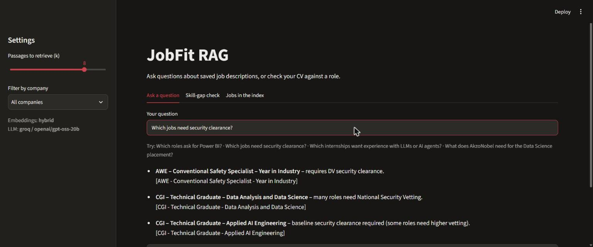
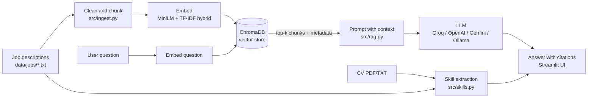

# JobFit RAG: Job Description Q&A and Skill-Gap Assistant

    

A Retrieval-Augmented Generation (RAG) app that answers questions about a set of job descriptions, with a citation for every answer, and checks a CV against any job to show which skills match and which are missing.

I built it to support my own graduate job search: instead of re-reading 30 job adverts, I can ask *"Which roles need Power BI?"* or *"Which jobs require security clearance?"* and get an answer that points to its source.



**Results at a glance** (details under [Evaluation](#evaluation)): correct answer for **35/35** test questions, **35/35** citations matching a real source, and the right job retrieved for **every** question with hybrid search.

## Features

- **Question answering with citations.** Retrieves the most relevant passages from ChromaDB and asks an LLM to answer only from them, citing `[Company - Job title]`. If the answer isn't in the job descriptions, it says so.
- **Hybrid search.** Combines semantic search (`all-MiniLM-L6-v2`) and keyword search (TF-IDF) with reciprocal rank fusion, so both exact phrases ("post-study work visa") and reworded questions ("smarter roads and railways") find the right job.
- **Skill-gap check.** Compares a job's requirements with your CV (PDF or TXT) and shows the skills you have, the skills to work on and a coverage score. With an LLM configured, it also gives practical advice.
- **Works without an API key.** With no LLM, it shows the best-matching passages instead (extractive mode).
- **Resilient to API limits.** If the main model hits a usage limit, it switches to backup models automatically; if no model is available it shows the best passages with a short notice instead of an error.
- **Evaluation built in.** Measures retrieval quality (Hit@1, Hit@3, MRR) across search methods and chunk sizes, plus an end-to-end check of the LLM's answers and citations.
- **Provider-agnostic LLM.** Works with any OpenAI-compatible API: Groq, OpenAI, Google Gemini or a local Ollama model.

## Architecture



| Step | File | What it does |
|---|---|---|
| 1. Data | `data/jobs.csv`, `data/jobs/*.txt` | 27 job descriptions with metadata (company, title, location, closing date) |
| 2. Clean and chunk | `src/ingest.py` | Normalises whitespace, removes boilerplate, splits into overlapping word windows, adds a company/title header to every chunk |
| 3. Embed and store | `src/embeddings.py`, `src/ingest.py` | Embeds chunks with `all-MiniLM-L6-v2` and TF-IDF and stores them in persistent ChromaDB collections |
| 4. Retrieve and generate | `src/retriever.py`, `src/rag.py`, `src/llm.py` | Hybrid search (semantic + keyword, merged with reciprocal rank fusion, optional company filter), then a grounded prompt to the LLM |
| 5. Interface | `app.py` | Streamlit app with Ask, Skill-gap and Jobs tabs |
| 6. Evaluation | `src/evaluate.py`, `eval/questions.csv` | 34 labelled questions; compares embeddings and chunk sizes |
| 7. Answer check | `src/check_answers.py` | Runs the questions through retrieval + LLM and compares each answer with the reference job; writes `results/llm_answers.md` |

## Quick start

```bash
git clone https://github.com/saravanaperumalsam-blip/jobfit-rag.git
cd jobfit-rag
python -m venv .venv         # Python 3.10 or newer
# Windows: .venv\Scripts\activate    macOS/Linux: source .venv/bin/activate
pip install -r requirements.txt

cp .env.example .env        # Windows: copy .env.example .env
# optional: for written answers, set LLM_PROVIDER=groq and LLM_API_KEY=<your key> in .env
# (free key at https://console.groq.com/keys; Gemini, OpenAI and local Ollama also work)

python -m src.ingest        # build the vector index
streamlit run app.py        # open http://localhost:8501
```

Command-line options:

```bash
python -m src.rag "Which jobs need security clearance?"
python -m src.skills arm_data_analytics_intern
python -m src.evaluate --backends minilm tfidf hybrid
python -m src.check_answers     # needs an LLM key in .env
pytest -q
```

## Evaluation

Each test question has one correct job. **Hit@k** is the share of questions where that job appears in the top k retrieved chunks. **MRR** is the mean reciprocal rank. Questions come in two types:

- **keyword**: shares words with the job text, e.g. *"Which role uses C# and WPF?"*
- **paraphrase**: same meaning, different words, e.g. *"Which role helps shipping companies cut their carbon footprint?"*

Results from `python -m src.evaluate --backends minilm tfidf hybrid` (full output in `results/eval_results.md`):

| Search | Chunk size (words) | Hit@1 | Hit@3 | MRR | Hit@1 keyword | Hit@1 paraphrase |
|---|---|---|---|---|---|---|
| TF-IDF | 40 | 0.88 | 0.94 | 0.91 | 0.96 | 0.70 |
| TF-IDF | 120 | 0.88 | 0.94 | 0.91 | 0.96 | 0.70 |
| MiniLM | 40 | 0.79 | 0.94 | 0.86 | 0.83 | 0.70 |
| MiniLM | 120 | 0.82 | 0.94 | 0.88 | 0.88 | 0.70 |
| **Hybrid (default)** | **40** | **0.85** | **0.94** | **0.90** | **0.88** | **0.80** |
| Hybrid | 120 | 0.85 | 0.94 | 0.90 | 0.88 | 0.80 |

With the default settings (hybrid search, 40-word chunks, top 8 passages) the correct job is among the passages sent to the LLM for **34/34** questions, against 32/34 for MiniLM or TF-IDF alone.

**End-to-end answer check** (`python -m src.check_answers`, Groq `openai/gpt-oss-20b`, the 34 questions plus "Which jobs need security clearance?"): the answer named the correct job(s) for **35/35** and every citation matched a real source (35/35).

**What I learned**

- Keyword search (TF-IDF) is near-perfect when the question uses the same words as the job advert, but drops to 60–70% Hit@1 on paraphrased questions. MiniLM alone did not close that gap on this small dataset; combining both (hybrid search) did best on paraphrases and never missed the right job in the top 8.
- When no query word appears in any job, TF-IDF produces an all-zero vector and ChromaDB returns jobs in a random order. The retriever now returns nothing in that case, so the hybrid ranking is not polluted by noise.
- Smaller chunks retrieved more precisely here, because each job description is short and each chunk covers one topic.
- Adding the company and job title to every chunk ("contextual headers") lets a chunk make sense on its own and lets the LLM cite it.

## Design decisions

- **ChromaDB** for a simple persistent vector store with metadata filtering (filter by company).
- **all-MiniLM-L6-v2** because it is small, fast on a laptop CPU and free.
- **Hybrid search with reciprocal rank fusion** because measurement showed neither method alone was enough: TF-IDF wins on exact wording, MiniLM on paraphrases. RRF merges rankings without having to calibrate the two score scales.
- **Small chunks with contextual headers** (company, title and location on every 40-word chunk), so a chunk is precise but still makes sense, and can be cited, on its own.
- **Grounded prompt**: the LLM must answer only from context, cite sources and say "I don't know" otherwise, which reduces hallucination. Each passage carries an exact `Cite as:` tag, and model output is normalised (e.g. `【…】` brackets, Unicode dashes) so citations always match a real source.
- **Graceful degradation**: backup models on rate limits, and an extractive answer with a clear notice if no model is available, so the app never shows a stack trace.
- **Rule-based skill extraction** for the skill gap. It is transparent, testable and repeatable. The LLM only writes advice on top of it.

## Limitations and next steps

- The job descriptions are short paraphrased summaries for a demo, not the original adverts.
- The evaluation set is small (34 questions) and written by me, so the scores are indicative only.
- Next steps: BM25 in place of TF-IDF, a cross-encoder re-ranker, automatic faithfulness scoring of LLM answers, and deployment on Streamlit Community Cloud.

## Project structure

```
jobfit-rag/
├── app.py                 Streamlit UI
├── src/
│   ├── config.py          settings (.env)
│   ├── ingest.py          load, clean, chunk, index
│   ├── embeddings.py      MiniLM / TF-IDF embedders
│   ├── retriever.py       ChromaDB search (MiniLM, TF-IDF or hybrid)
│   ├── llm.py             OpenAI-compatible LLM client with backup models
│   ├── rag.py             grounded Q&A with citations
│   ├── skills.py          CV skill-gap analysis
│   ├── evaluate.py        retrieval evaluation
│   └── check_answers.py   end-to-end LLM answer check
├── data/                  job descriptions + sample CV
├── eval/questions.csv     labelled test questions
├── results/               evaluation output
├── tests/                 pytest tests
└── docs/                  screenshots
```

## Data note

The job descriptions in `data/jobs/` are short summaries written for this project from public graduate job listings. They are not the employers' original adverts. Add your own by putting a `.txt` file in `data/jobs/`, adding a row to `data/jobs.csv` and running `python -m src.ingest`.

## License

MIT
